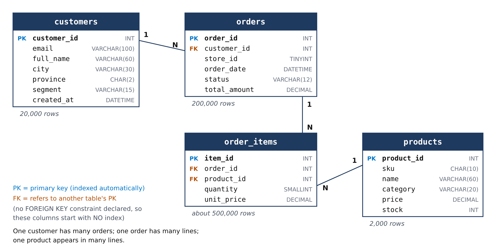
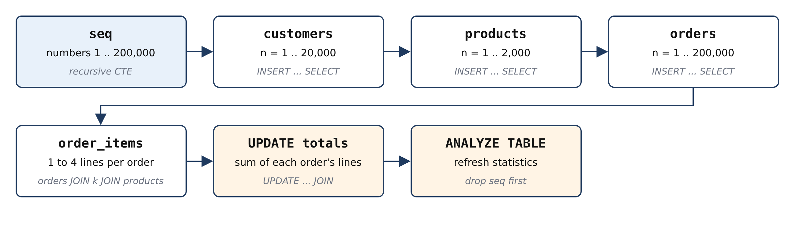
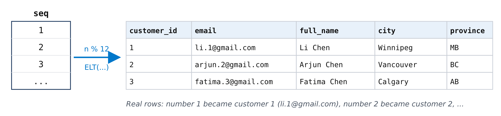
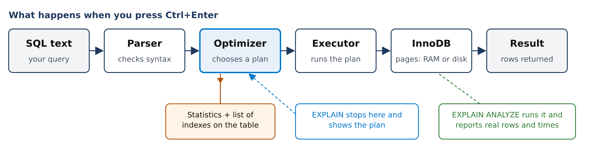
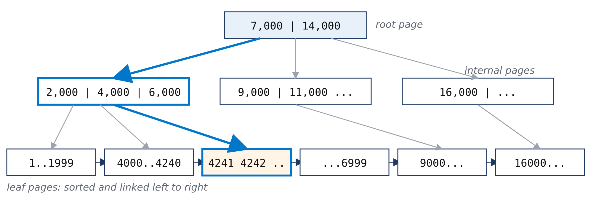
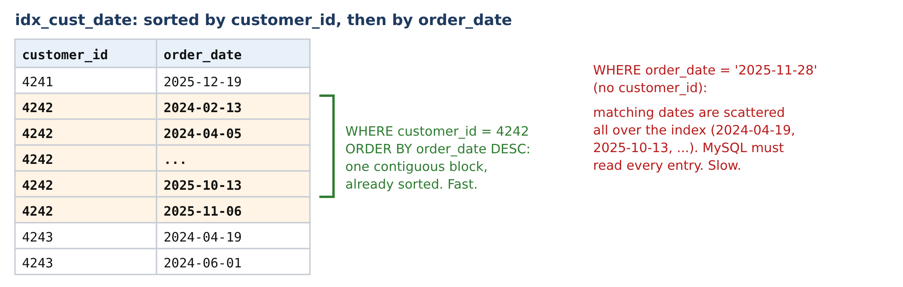
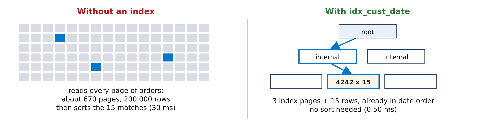
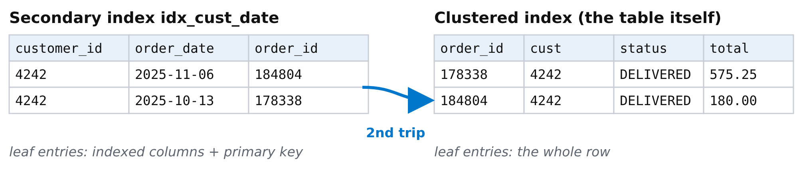
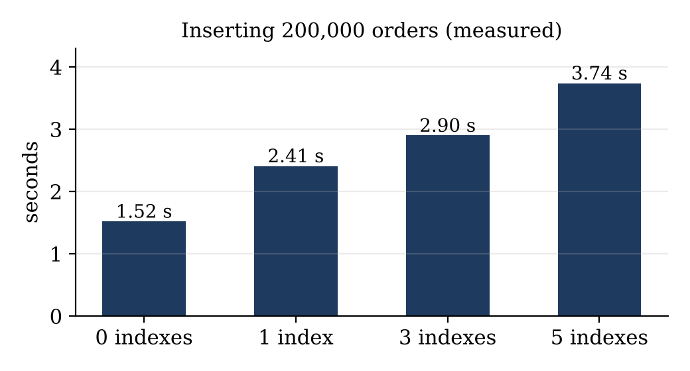
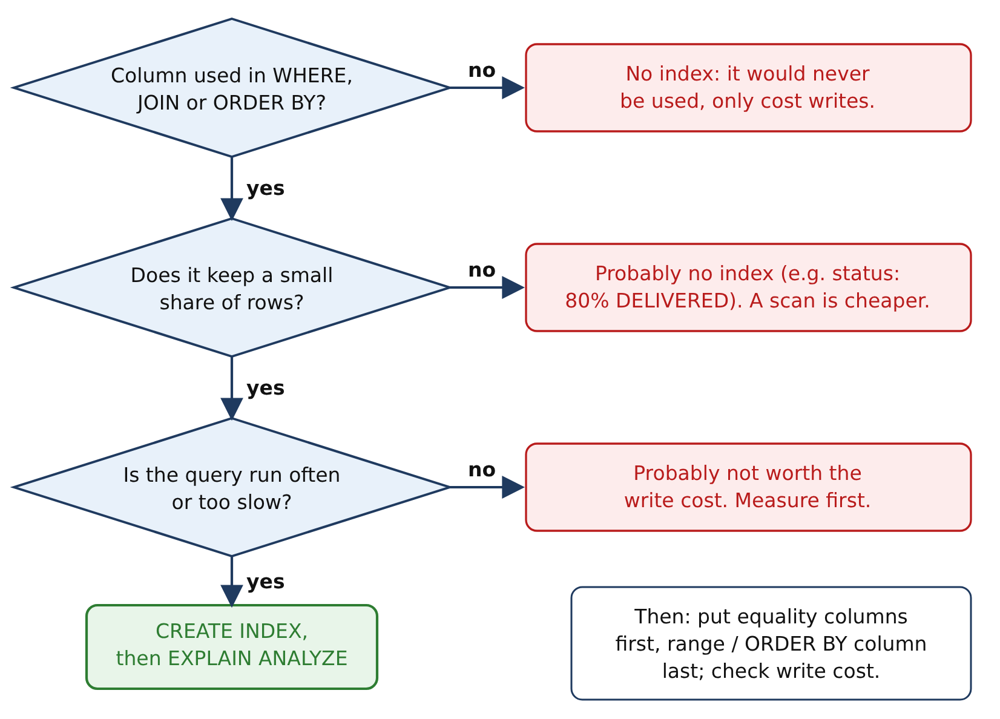

# Database Indexing Activity

In this activity you take a slow query on a realistic database, find out *why* it is slow, and make it about a hundred times faster with indexes. Everything you need is in this handout. Each step gives you the SQL to copy into MySQL Workbench, the output we got, an explanation of that output, and a **Try this** part with a small change to explore. All outputs were captured from a real MySQL 8.0 server running the same scripts. Your times will differ because your computer is different; the plans and row counts should match.

> **The situation.** MapleMart, a Canadian retail chain, sells online. On Black Friday its “My orders” page became slow. The page runs one query: show the 20 most recent orders of the signed-in customer. Customer 4242 (Omar) has only 15 orders, yet the query needs about 30 ms of database time, and on a busy day thousands of customers open that page every minute.

**You need** MySQL Server 8.0 or newer (check with `SELECT VERSION();`) and MySQL Workbench. Open a new SQL tab, paste one block of code at a time and run it with the lightning-bolt icon (**Ctrl+Shift+Enter** runs every statement in the tab). Workbench shows rows in the **Result Grid** and the time each statement took in the **Action Output** panel (column “Duration”). Run the blocks in the order they appear.

## Step 1. Build the database

The database has four tables. The diagram shows them, their columns and how they are related. Read it before you start: every query in this activity uses these tables.



*Figure 1. The `maplemart_index` schema. PK marks each table's primary key; FK marks a column that refers to another table's primary key. The lines show the relationships: one customer has many (N) orders, one order has many lines, and one product appears in many lines.*

A **primary key** uniquely identifies each row, and MySQL indexes it automatically. A **foreign key** column (like `orders.customer_id`) points to a row in another table. If you declare it with a `FOREIGN KEY` constraint, MySQL also creates an index on it automatically. We deliberately **did not** declare those constraints, so that `customer_id`, `order_id` and `product_id` start with no index. That lets us see what an index changes.

Step 1 builds the database in eight blocks of SQL, 1a to 1h. Run them in order; together they take well under a minute. The flowchart shows what they do:



*Figure 2. The setup steps. A helper table of numbers is created first; every other table is generated from it with one `INSERT ... SELECT` statement.*

### 1a. The database and the recursion limit

```sql
DROP DATABASE IF EXISTS maplemart_index;
CREATE DATABASE maplemart_index;
USE maplemart_index;
SET SESSION cte_max_recursion_depth = 1000000;
```

`DROP DATABASE IF EXISTS` removes an old copy so you can repeat Step 1 any time. `USE` makes every following statement work inside `maplemart_index`. The `SET SESSION cte_max_recursion_depth` line matters for the next part: MySQL stops a recursive query after 1,000 repetitions by default, as a safety net against endless loops. We need 200,000 repetitions, so we raise the limit to 1,000,000 for this connection only (`SESSION`).

#### Try this: what happens without that line?

Open a new SQL tab with a new connection (the setting belongs to one connection), run `USE maplemart_index;` and then block 1b. Without the raised limit you get:

```text
ERROR 3636 (HY000): Recursive query aborted after 1001 iterations.
Try increasing @@cte_max_recursion_depth to a larger value.
```

### 1b. A table of numbers

```sql
CREATE TABLE seq (n INT PRIMARY KEY);

INSERT INTO seq (n)
WITH RECURSIVE s (n) AS (
  SELECT 1
  UNION ALL
  SELECT n + 1 FROM s WHERE n < 200000
)
SELECT n FROM s;
```

A **recursive CTE** (common table expression) is a query that refers to itself. It starts with one row (`SELECT 1`) and repeatedly adds the next number (`n + 1`) until the condition `n < 200000` stops it. The result, 1 to 200,000, is stored in the helper table `seq`. Every other table is generated from these numbers: number n becomes customer n, product n and order n.

**Why not just loop and insert one row at a time?** Because it is slow. We measured inserting 200,000 orders three ways: one `INSERT` per row in a loop (each its own transaction) managed only 20,000 rows in 9 seconds, so about a minute and a half for all 200,000; the same loop inside a single transaction took 2.5 s; one `INSERT ... SELECT` took 0.8 s. One statement that produces many rows lets MySQL do the work in bulk.



*Figure 3. How numbers become rows. Each number n from `seq` becomes customer n; formulas on n decide the name, email and city.*

### 1c. Customers (20,000 rows)

```sql
CREATE TABLE customers (
  customer_id INT PRIMARY KEY,
  email       VARCHAR(100) NOT NULL,
  full_name   VARCHAR(60)  NOT NULL,
  city        VARCHAR(30)  NOT NULL,
  province    CHAR(2)      NOT NULL,
  segment     VARCHAR(15)  NOT NULL,
  created_at  DATETIME     NOT NULL
);

INSERT INTO customers
SELECT n,
       CONCAT(ELT(1 + n % 12, 'maria', 'li', 'arjun', 'fatima',
                              'noah', 'emma', 'omar', 'sofia',
                              'liam', 'aisha', 'chen', 'olivia'),
              '.', n, '@',
              ELT(1 + (n DIV 7) % 4, 'gmail.com', 'outlook.com',
                                     'yahoo.ca', 'algomau.ca')),
       CONCAT(ELT(1 + n % 12, 'Maria', 'Li', 'Arjun', 'Fatima',
                              'Noah', 'Emma', 'Omar', 'Sofia',
                              'Liam', 'Aisha', 'Chen', 'Olivia'),
              ' ',
              ELT(1 + (n DIV 12) % 10, 'Chen', 'Singh', 'Ahmed', 'Tremblay',
                                       'Smith', 'Nguyen', 'Brown', 'Khan',
                                       'Roy', 'Wilson')),
       ELT(1 + (n * 7) % 8, 'Toronto', 'Brampton', 'Ottawa', 'Montreal',
                            'Halifax', 'Calgary', 'Vancouver', 'Winnipeg'),
       ELT(1 + (n * 7) % 8, 'ON', 'ON', 'ON', 'QC', 'NS', 'AB', 'BC', 'MB'),
       ELT(1 + (n * 13) % 10, 'Consumer', 'Consumer', 'Consumer', 'Consumer',
                              'Consumer', 'Consumer', 'Consumer',
                              'Student', 'Student', 'Business'),
       '2021-01-01' + INTERVAL (n * 37) % 1700 DAY
FROM seq
WHERE n <= 20000;
```

`INSERT INTO customers SELECT ... FROM seq WHERE n <= 20000` inserts one row for every number from 1 to 20,000. Two functions do most of the work. `n % 12` is n **modulo** 12, the remainder after dividing by 12, so it cycles 0, 1, ..., 11, 0, 1, ... . `ELT(k, a, b, c, ...)` returns the k-th item of a list, so `ELT(1 + n % 12, 'maria', 'li', ...)` cycles through 12 first names. `CONCAT` joins pieces of text into one string, giving emails like `maria.4320@outlook.com`. `INSERT ... SELECT` inserts every row the `SELECT` returns, so one statement creates all 20,000 customers.

The other columns follow the same idea. City and province use the same position `1 + (n * 7) % 8` in two lists, so a Toronto customer is always in ON. The segment list holds Consumer seven times, Student twice and Business once, so 70% of customers are consumers. The sign-up date is 1 January 2021 plus between 0 and 1,699 days.

**How the first name is chosen.** `ELT(k, ...)` returns the k-th name in the list, and `k = 1 + n % 12`:

| customer n | n % 12 | k = 1 + n % 12 | first name |
|---|---|---|---|
| 1 | 1 | 2 | li |
| 2 | 2 | 3 | arjun |
| 6 | 6 | 7 | omar |
| 11 | 11 | 12 | olivia |
| **12** | **0** | **1** | **maria** |
| 13 | 1 | 2 | li |
| 4242 | 6 | 7 | omar |

So customer 1 is Li, not Maria: `maria` comes up only when n is a multiple of 12 (customers 12, 24, 36, ...). Customer 4242 is Omar because 4242 % 12 = 6. The surname uses `n DIV 12` (whole-number division), so it changes once every 12 customers.

#### Try this: predict the names first

Before running it, predict the first names of customers 1, 2, 11, 12, 24 and 4242:

```sql
SELECT customer_id, full_name, email
FROM customers
WHERE customer_id IN (1, 2, 11, 12, 24, 4242);
```

Output:

| customer_id | full_name | email |
|---|---|---|
| 1 | Li Chen | li.1@gmail.com |
| 2 | Arjun Chen | arjun.2@gmail.com |
| 11 | Olivia Chen | olivia.11@outlook.com |
| 12 | Maria Singh | maria.12@outlook.com |
| 24 | Maria Ahmed | maria.24@algomau.ca |
| 4242 | Omar Tremblay | omar.4242@yahoo.ca |

<sub>6 rows returned in 0.0014 sec</sub>

### 1d. Products (2,000 rows)

```sql
CREATE TABLE products (
  product_id INT PRIMARY KEY,
  sku        CHAR(10)      NOT NULL,
  name       VARCHAR(60)   NOT NULL,
  category   VARCHAR(20)   NOT NULL,
  price      DECIMAL(8,2)  NOT NULL,
  stock      INT           NOT NULL
);

INSERT INTO products
SELECT n,
       CONCAT('SKU', LPAD(n, 7, '0')),
       CONCAT(ELT(1 + n % 4, 'Electronics', 'Home', 'Grocery', 'Apparel'),
              ' item ', n),
       ELT(1 + n % 4, 'Electronics', 'Home', 'Grocery', 'Apparel'),
       ROUND(ELT(1 + n % 4, 60, 25, 4, 15) * (1 + (n * 31) % 40 / 4), 2),
       (n * 17) % 500
FROM seq
WHERE n <= 2000;
```

Four categories with 500 products each. `LPAD(n, 7, '0')` pads the number with zeros to 7 digits for the SKU code. The price is a base price for the category (60, 25, 4 or 15 dollars) multiplied by a factor between 1 and about 11, so electronics are expensive and groceries cheap. The stock is a number from 0 to 499.

### 1e. Orders (200,000 rows)

```sql
CREATE TABLE orders (
  order_id     INT PRIMARY KEY,
  customer_id  INT           NOT NULL,
  store_id     TINYINT       NOT NULL,
  order_date   DATETIME      NOT NULL,
  status       VARCHAR(12)   NOT NULL,
  total_amount DECIMAL(10,2) NOT NULL
);

INSERT INTO orders
SELECT n,
       1 + CRC32(CONCAT('c', n)) % 20000,
       1 + (n * 11) % 9,
       '2024-01-01' + INTERVAL FLOOR(n * 315.792) SECOND,
       CASE WHEN CRC32(CONCAT('s', n)) % 100 < 80 THEN 'DELIVERED'
            WHEN CRC32(CONCAT('s', n)) % 100 < 89 THEN 'SHIPPED'
            WHEN CRC32(CONCAT('s', n)) % 100 < 97 THEN 'PENDING'
            ELSE 'CANCELLED' END,
       0                                   -- filled in by step 1g
FROM seq;
```

`CRC32` is a checksum function: it turns text into a large number that looks random but is always the same for the same input. Taking it modulo 20,000 assigns each order to a customer from 1 to 20,000, about 10 orders per customer, and identically on every computer. That is why customer 4242 always has the same 15 orders. The `CASE` expression splits a second checksum into status buckets: 80% DELIVERED, 9% SHIPPED, 8% PENDING, 3% CANCELLED. The store is a number from 1 to 9. Order n is placed n x 315.792 seconds (about 5 minutes) after 1 January 2024, which spreads 200,000 orders evenly over 2024 and 2025. The total starts at 0 and is filled in by 1g.

### 1f. Order lines (about 500,000 rows)

```sql
CREATE TABLE order_items (
  item_id    INT AUTO_INCREMENT PRIMARY KEY,
  order_id   INT          NOT NULL,
  product_id INT          NOT NULL,
  quantity   SMALLINT     NOT NULL,
  unit_price DECIMAL(8,2) NOT NULL
);

INSERT INTO order_items (order_id, product_id, quantity, unit_price)
SELECT o.order_id,
       p.product_id,
       1 + (o.order_id + k.k) % 3,
       p.price
FROM orders o
JOIN (SELECT 1 AS k UNION ALL SELECT 2
      UNION ALL SELECT 3 UNION ALL SELECT 4) k
  ON k.k <= 1 + o.order_id % 4             -- 1 to 4 lines per order
JOIN products p
  ON p.product_id = 1 + (o.order_id * 7 + k.k * 131) % 2000;
```

Each order needs 1 to 4 lines. The small table `k` holds the numbers 1 to 4. Joining every order with `k`, but keeping only rows where `k.k <= 1 + order_id % 4`, produces 1, 2, 3 or 4 rows per order. A second join picks a product for each line and copies its price. `item_id` is `AUTO_INCREMENT`, so MySQL numbers the lines 1, 2, 3, ... by itself.

### 1g. Totals, clean-up and statistics

```sql
UPDATE orders o
JOIN (SELECT order_id, SUM(quantity * unit_price) AS t
      FROM order_items
      GROUP BY order_id) s
  ON s.order_id = o.order_id
SET o.total_amount = s.t;

DROP TABLE seq;

ANALYZE TABLE customers, products, orders, order_items;
```

The `UPDATE ... JOIN` sums each order's lines and writes the total into the order. `ANALYZE TABLE` refreshes the **statistics**: the row counts and numbers of distinct values that MySQL's query optimizer uses to choose plans. `DROP TABLE seq` removes the helper table, which is no longer needed.

### 1h. Check the row counts

```sql
SELECT 'customers' AS tbl, COUNT(*) AS row_count FROM customers
UNION ALL SELECT 'products',    COUNT(*) FROM products
UNION ALL SELECT 'orders',      COUNT(*) FROM orders
UNION ALL SELECT 'order_items', COUNT(*) FROM order_items;
```

Output:

| tbl | row_count |
|---|---|
| customers | 20000 |
| products | 2000 |
| orders | 200000 |
| order_items | 500000 |

<sub>4 rows returned in 0.0285 sec</sub>

This counts the rows of all four tables and shows the counts together. `UNION ALL` stacks the rows of several `SELECT`s into one result, so you get one small table instead of four separate result tabs. Each `SELECT` returns a text label (`'customers'` is a fixed string, not a table name) and a count. Only the first `SELECT` names the columns (`AS tbl`, `AS row_count`), because a `UNION` always takes its column names from the first query. `ALL` keeps every row as it is; plain `UNION` would also check for duplicate rows, which is wasted work here because the four labels are all different.

**Check your output.** If your counts match, your data is identical to ours, row for row. If a block fails with “Error Code: 2013. Lost connection to MySQL server during query”, Workbench stopped waiting: go to Edit > Preferences > SQL Editor, set “DBMS connection read timeout” to 600 seconds, reconnect and run it again.

#### Try this: look at the generated data

```sql
SELECT * FROM orders LIMIT 5;
```

Output:

| order_id | customer_id | store_id | order_date | status | total_amount |
|---|---|---|---|---|---|
| 1 | 19458 | 3 | 2024-01-01 00:05:15 | DELIVERED | 385.25 |
| 2 | 6492 | 5 | 2024-01-01 00:10:31 | DELIVERED | 937.50 |
| 3 | 10670 | 7 | 2024-01-01 00:15:47 | DELIVERED | 826.25 |
| 4 | 15119 | 9 | 2024-01-01 00:21:03 | DELIVERED | 180.00 |
| 5 | 3033 | 2 | 2024-01-01 00:26:18 | DELIVERED | 162.75 |

<sub>5 rows returned in 0.0005 sec</sub>

Order 1 was placed 5 minutes 15 seconds after midnight on 1 January 2024, order 2 about 5 minutes later, and so on: exactly the `n x 315.792` seconds rule. Now confirm that `orders` has only its primary key index:

```sql
SHOW INDEX FROM orders;
```

Output:

| Table | Key_name | Column_name | Cardinality | Index_type |
|---|---|---|---|---|
| orders | PRIMARY | order_id | 199496 | BTREE |

<sub>1 row returned in 0.0033 sec</sub>

One row: the table has exactly one index, the `PRIMARY` key on `order_id`, which MySQL created automatically. There is nothing for `customer_id` yet, and that is why the query in Step 2 is slow.

**This output describes the index; it does not show the data inside it.** Each row of `SHOW INDEX` describes one column of one index. The index itself has 200,000 entries, one per order. Think of it as the label on a box, not the contents of the box. The most useful columns are:

| Column | Our value | Meaning |
|---|---|---|
| `Key_name` | PRIMARY | Name of the index. The primary key is always called PRIMARY. |
| `Non_unique` | 0 | 0 = values must be unique (no two orders share an id). 1 = duplicates allowed. |
| `Seq_in_index` | 1 | Position of this column inside the index. A two-column index shows two rows, numbered 1 and 2. |
| `Column_name` | order_id | The indexed column. |
| `Cardinality` | about 200,000 | MySQL's **estimate** of the number of distinct values. It samples a few pages, so your number will be slightly different. |
| `Index_type` | BTREE | The structure of the index: a B+tree (Step 3). |

## Step 2. Ask MySQL how it runs the slow query

Before changing anything, find out what MySQL actually does. The figure shows what happens to every query you run. The **query optimizer** is the part that chooses *how* to run it, using statistics and the list of indexes on the table. Its choice is the **execution plan**.



*Figure 4. The path of a query. `EXPLAIN` shows the plan the optimizer chose without running it; `EXPLAIN ANALYZE` runs the plan and reports what really happened.*

Here is the “My orders” query. Run it once:

```sql
SELECT order_id, order_date, status, total_amount
FROM orders
WHERE customer_id = 4242
ORDER BY order_date DESC
LIMIT 20;
```

Output:

| order_id | order_date | status | total_amount |
|---|---|---|---|
| 184804 | 2025-11-06 11:00:24 | DELIVERED | 180.00 |
| 178338 | 2025-10-13 19:48:33 | DELIVERED | 575.25 |
| 175581 | 2025-10-03 17:57:55 | SHIPPED | 199.50 |
| 173270 | 2025-09-25 07:14:39 | CANCELLED | 703.50 |

<sub>... 11 more rows</sub>

<sub>15 rows returned in 0.0299 sec</sub>

Fifteen rows, the 15 orders of customer 4242, newest first. Now put `EXPLAIN` in front of the same query:

```sql
EXPLAIN
SELECT order_id, order_date, status, total_amount
FROM orders
WHERE customer_id = 4242
ORDER BY order_date DESC
LIMIT 20;
```

Output:

| type | possible_keys | key | rows | filtered | Extra |
|---|---|---|---|---|---|
| ALL | NULL | NULL | 199496 | 10.0 | Using where; Using filesort |

<sub>1 row returned in 0.0004 sec</sub>

**Your output looks different?** If it is a single column named `EXPLAIN` with text like `-> Limit: 20 row(s) ...`, your MySQL version (8.0.32 or newer) is set to show plans as a tree. Run `SET explain_format = TRADITIONAL;` once, or write `EXPLAIN FORMAT=TRADITIONAL`, to get the table shown here.

**What the output means.** Each column describes one part of the plan:

| Column | Meaning | Here |
|---|---|---|
| `type` | How the table is read. The most important column. `ALL` = **full table scan**: read every row. | `ALL`, the worst case |
| `possible_keys` | Indexes that could help. | none |
| `key` | The index actually used. | `NULL`: no index |
| `rows` | Estimated rows MySQL will examine (an estimate, not a count). | about 200,000 to return 15 |
| `filtered` | Estimated % of those rows that pass the WHERE condition. | 10%, a rough guess |
| `Extra` | Extra work. `Using where`: rows are checked after reading. `Using filesort`: a separate sort step. | both |

`EXPLAIN ANALYZE` actually runs the query and adds what really happened at each step:

```sql
EXPLAIN ANALYZE
SELECT order_id, order_date, status, total_amount
FROM orders
WHERE customer_id = 4242
ORDER BY order_date DESC
LIMIT 20;
```

Output:

```text
-> Limit: 20 row(s)  (cost=20118 rows=20) (actual time=38.1..38.1 rows=15 loops=1)
    -> Sort: orders.order_date DESC, limit input to 20 row(s) per chunk  (cost=20118
          rows=199496) (actual time=38.1..38.1 rows=15 loops=1)
        -> Filter: (orders.customer_id = 4242)  (cost=20118 rows=199496) (actual
              time=2.31..38.1 rows=15 loops=1)
            -> Table scan on orders  (cost=20118 rows=199496) (actual time=0.209..30.5
                  rows=200000 loops=1)
```

<sub>1 row returned (the plan, as text)</sub>

**How to read it.** The plan is a **pipeline**. Each line is one step. Rows enter at the bottom, each step does one job and passes its rows up, and the top line hands the result to you. So read it **from the bottom line up**:

```text
 4. Limit        keep at most 20                -->  15 rows to you
       ^
 3. Sort         newest first (order_date)      -->  15 rows
       ^
 2. Filter       keep customer_id = 4242        -->  15 rows survive
       ^
 1. Table scan   read every order               -->  200,000 rows
```

| Step | Line in the output | What it does | Rows out |
|---|---|---|---|
| 1 | `Table scan on orders` | Reads every row of the table, from order 1 to order 200,000 | 200,000 |
| 2 | `Filter: (orders.customer_id = 4242)` | Checks each row: is it Omar's? Throws the others away | 15 |
| 3 | `Sort: orders.order_date DESC` | Puts Omar's 15 orders newest first | 15 |
| 4 | `Limit: 20 row(s)` | Stops at 20 rows; Omar has only 15, so all pass | 15 |

MySQL did 200,000 rows of work to give you 15. That is the whole problem in one picture.

**The two brackets on every line.** The first bracket is the optimizer's **guess**, made before running; the second is the **measurement**, made while running (only `EXPLAIN ANALYZE` has it):

```text
(cost=20118 rows=199496)   (actual time=0.209..30.5 rows=200000 loops=1)
 \__ the plan: a guess __/    \_________ what really happened _________/
```

- `cost`: an abstract work score; bigger means more work. It is not milliseconds.

- `rows` (first bracket): how many rows the step was expected to produce.

- `actual time=A..B`: milliseconds from the start until the step produced its **first** row (A) and its **last** row (B). Each time includes the steps below it.

- `rows` (second bracket): how many rows the step really produced. `loops`: how many times the step ran.

| Step | actual time | What the numbers say |
|---|---|---|
| Table scan | 0.209..**30.5** | Finished reading all 200,000 rows after 30.5 ms. |
| Filter | 2.31..**38.1** | Found Omar's first order after 2.31 ms, but had to check every row to the end to be sure there were no more. |
| Sort, Limit | 38.1..38.1 | Sorting 15 rows takes almost no time. |

So about **30 of the 38 ms are spent reading rows that are thrown away**. An index removes exactly that step. Notice also that the optimizer guessed 199,496 rows would pass the filter, but only 15 did: with no index on `customer_id`, MySQL knows very little about that column.

### Why is reading every row slow?

MySQL's storage engine, InnoDB, stores a table in **pages**: fixed 16 KB blocks holding a few hundred rows each. MySQL always reads whole pages. The orders table is about 670 pages; 621 of them hold the rows themselves, about 320 orders each. Omar's 15 orders were placed on different days over two years, so they sit on 15 different pages scattered through the table. Without an index there is no way to know which ones, so every page is read. Pages already in memory sit in the **buffer pool**, InnoDB's cache in RAM; reading from disk instead is roughly a thousand times slower.


*Figure 5. The orders table drawn page by page, with Omar's 15 orders shown on the pages where they really are. A full table scan reads all 621 pages to find the 15 blue ones.*

#### Try this: a customer with more orders

Find the customers with the most orders, then explain the query for the top one:

```sql
SELECT customer_id, COUNT(*) AS orders
FROM orders
GROUP BY customer_id
ORDER BY orders DESC
LIMIT 3;
```

Output:

| customer_id | orders |
|---|---|
| 5572 | 24 |
| 3126 | 24 |
| 19708 | 23 |

<sub>3 rows returned in 0.0497 sec</sub>

```sql
EXPLAIN
SELECT order_id, order_date, status, total_amount
FROM orders
WHERE customer_id = 5572
ORDER BY order_date DESC
LIMIT 20;
```

Output:

| type | key | rows | Extra |
|---|---|---|---|
| ALL | NULL | 199496 | Using where; Using filesort |

<sub>1 row returned in 0.0005 sec</sub>

The plan is identical: `ALL`, about 200,000 rows. Without an index, the cost is the same for every customer, whether they have 1 order or 24, because the whole table is read either way.

## Step 3. Add an index

An **index** is a separate structure that stores the values of one or more columns **in sorted order**, each with a pointer to its row, like the index at the back of a textbook. MySQL's ordinary indexes are **B+trees**:



*Figure 6. Searching a B+tree for customer 4242: read the root page, follow one pointer to an internal page, then one more to the leaf page that holds the entries. Three page reads instead of about 670.*

A B+tree is **balanced** (every leaf is at the same depth, so every lookup costs the same), has a **high fan-out** (one page holds hundreds of keys, so even a billion rows need only 3 or 4 levels) and has **linked leaves** (after the first match, neighbouring values are read in order, which makes ranges and sorting cheap).

**The primary key is a B+tree too.** That is why searching by `order_id` was never slow. Imagine a table of only 2,000 orders, about 200 per page:

```text
PRIMARY (the table itself, sorted by order_id)

root page:    [ 201 | 401 | 601 | 801 | 1001 | 1201 | 1401 | 1601 | 1801 ]
                                                                       |
leaf pages:   [1..200] [201..400] ... [1601..1800] [1801..2000] <------+
                                                    binary search inside -> row 1999
```

To find order 1999, MySQL reads the root page (1999 is at least 1801, so it follows the last pointer), then reads that leaf page and searches inside it. That is 2 page reads and about 11 comparisons, not 1,999. On our real table:

```sql
EXPLAIN
SELECT * FROM orders WHERE order_id = 1999;
```

Output:

| type | possible_keys | key | rows | Extra |
|---|---|---|---|---|
| const | PRIMARY | PRIMARY | 1 | NULL |

<sub>1 row returned in 0.0010 sec</sub>

`type = const` means at most one row, found through the primary key: the fastest access there is. The slow case is a search on a column that has **no** index of its own, like `customer_id`. The table is sorted by `order_id`, which says nothing about customers, so MySQL must read every row. Create an index on the column in the WHERE clause:

```sql
CREATE INDEX idx_cust ON orders (customer_id);
```

<sub>OK, 0 rows affected (0.2 sec)</sub>

Read it as: create an index named `idx_cust` on table `orders`, column `customer_id`. Now explain the query again:

```sql
EXPLAIN
SELECT order_id, order_date, status, total_amount
FROM orders
WHERE customer_id = 4242
ORDER BY order_date DESC
LIMIT 20;
```

Output:

| type | possible_keys | key | rows | filtered | Extra |
|---|---|---|---|---|---|
| ref | idx_cust | idx_cust | 15 | 100.0 | Using filesort |

<sub>1 row returned in 0.0006 sec</sub>

**What changed.** `type` went from `ALL` to `ref` (“look up rows matching a value through an index”), `key` shows the new index, and `rows` dropped from about 200,000 to 15. The query time dropped from about 30 ms to 0.30 ms. One thing remains: `Using filesort`. The index finds Omar's orders but not in date order, so MySQL still sorts them (“filesort” is MySQL's name for any extra sort).

#### Try this: the index adapts to the customer

```sql
EXPLAIN
SELECT order_id, order_date, status, total_amount
FROM orders
WHERE customer_id = 5572
ORDER BY order_date DESC
LIMIT 20;
```

Output:

| type | key | rows | Extra |
|---|---|---|---|
| ref | idx_cust | 24 | Using filesort |

<sub>1 row returned in 0.0008 sec</sub>

Now `rows` is 24, exactly that customer's number of orders. With an index, the work depends on how many rows *match*, not on the size of the table. You can also see the new index and its cardinality (about 20,000 distinct customers):

```sql
SHOW INDEX FROM orders;
```

Output:

| Key_name | Column_name | Cardinality | Index_type |
|---|---|---|---|
| PRIMARY | order_id | 199496 | BTREE |
| idx_cust | customer_id | 19338 | BTREE |

<sub>2 rows returned in 0.0024 sec</sub>

## Step 4. A composite index: find and sort in one step

A **composite index** covers several columns. It is sorted by the first column and, within equal values, by the second, like a phone book sorted by last name and then first name. Replace the single-column index:

```sql
DROP INDEX idx_cust ON orders;
CREATE INDEX idx_cust_date ON orders (customer_id, order_date);
```



*Figure 7. Entries of `idx_cust_date`. Omar's entries form one block that is already in date order. A query on the date alone cannot use the order, because matching dates are scattered.*

**What is actually inside the index?** `SHOW INDEX` only describes it. To see the entries, select the same columns in the same order:

```sql
SELECT customer_id, order_date, order_id
FROM orders
WHERE customer_id BETWEEN 4241 AND 4243
ORDER BY customer_id, order_date;
```

| customer_id | order_date | order_id |
|---|---|---|
| 4241 | 2025-12-19 21:38:48 | 196690 |
| **4242** | **2024-02-13 00:48:55** | **11774** |
| **4242** | **2024-04-05 11:09:31** | **26119** |
| **4242** | **2024-06-23 07:32:32** | **47692** |
| **4242** | ... 10 more ... | ... |
| **4242** | **2025-10-13 19:48:33** | **178338** |
| **4242** | **2025-11-06 11:00:24** | **184804** |
| 4243 | 2024-04-19 10:30:44 | 29942 |

These rows are what the index stores, in the order it stores them (trimmed here). Every entry holds three values:

```text
idx_cust_date entry:  ( customer_id , order_date          , order_id )
                      (    4242     , 2025-11-06 11:00:24 , 184804   )
                         search key   sort order inside     pointer to the
                                      the customer block    full row (free)
```

- **customer_id** is what MySQL searches for: jump to 4242 in the B+tree.

- **order_date** is not searched. It only decides the order of Omar's entries, so no sort is needed.

- **order_id** is added to every entry automatically: InnoDB stores the primary key in every secondary index entry, as the pointer back to the full row in the table.

Omar's 15 orders are scattered through the table (Figure 5) but sit **next to each other** in the index, already in date order. Now look at the description again:

```sql
SHOW INDEX FROM orders;
```

Output:

| Key_name | Non_unique | Seq_in_index | Column_name | Cardinality |
|---|---|---|---|---|
| PRIMARY | 0 | 1 | order_id | 199465 |
| idx_cust_date | 1 | 1 | customer_id | 19972 |
| idx_cust_date | 1 | 2 | order_date | 199465 |

<sub>3 rows returned in 0.0022 sec</sub>

`idx_cust_date` appears twice because it has two columns (`Seq_in_index` 1 and 2). **Why is its cardinality only about 20,000 when there are 200,000 entries?** Cardinality counts *distinct values* of the columns up to that position, not entries. Each customer has about 10 orders, so the 200,000 entries contain only about 20,000 different `customer_id` values. Add `order_date` and almost every (customer, date) pair is different again. The exact counts:

```sql
SELECT COUNT(*)                                AS entries,
       COUNT(DISTINCT customer_id)             AS customers,
       COUNT(DISTINCT customer_id, order_date) AS customer_date
FROM orders;
```

Output:

| entries | customers | customer_date |
|---|---|---|
| 200000 | 20000 | 200000 |

<sub>1 row returned in 0.1870 sec</sub>

For the optimizer this is the useful number: 200,000 rows / 20,000 customers = about 10 rows per customer, so `WHERE customer_id = 4242` keeps a tiny share of the table and the index is worth using.

Now explain the “My orders” query with the new index:

```sql
EXPLAIN
SELECT order_id, order_date, status, total_amount
FROM orders
WHERE customer_id = 4242
ORDER BY order_date DESC
LIMIT 20;
```

Output:

| type | possible_keys | key | rows | filtered | Extra |
|---|---|---|---|---|---|
| ref | idx_cust_date | idx_cust_date | 15 | 100.0 | Backward index scan |

<sub>1 row returned in 0.0008 sec</sub>

**What changed.** `Using filesort` is gone. Because Omar's entries are already in date order, MySQL reads them from the newest backwards (**Backward index scan**) and stops after 20. `EXPLAIN ANALYZE` shows a single step:

```sql
EXPLAIN ANALYZE
SELECT order_id, order_date, status, total_amount
FROM orders
WHERE customer_id = 4242
ORDER BY order_date DESC
LIMIT 20;
```

Output:

```text
-> Limit: 20 row(s)  (cost=5.25 rows=15) (actual time=0.0836..0.138 rows=15 loops=1)
    -> Index lookup on orders using idx_cust_date (customer_id=4242) (reverse)  (cost=5.25
          rows=15) (actual time=0.0826..0.135 rows=15 loops=1)
```

<sub>1 row returned (the plan, as text)</sub>



*Figure 8. The same query before and after: about 200,000 rows read and sorted, versus a few index pages and 15 rows already in order.*

**The leftmost prefix rule.** A composite index on (A, B) helps conditions on A, or on A and B, but not on B alone. In the phone book, finding everyone named “Omar” (a first name) means reading the whole book. We test this in Step 6.

#### Try this: the same query with and without the index

`IGNORE INDEX` tells MySQL to act as if an index did not exist, so you can compare both plans without dropping anything. Run each query twice and compare the second **Duration**:

```sql
SELECT order_id, order_date, status, total_amount
FROM orders IGNORE INDEX (idx_cust_date)
WHERE customer_id = 4242
ORDER BY order_date DESC;
```

```sql
SELECT order_id, order_date, status, total_amount
FROM orders
WHERE customer_id = 4242
ORDER BY order_date DESC;
```

| Query | type | key | rows read | Time (ours) |
|---|---|---|---|---|
| With `IGNORE INDEX` | ALL | NULL | 200,000 | 38 ms |
| Normal | ref | idx_cust_date | 15 | 0.65 ms |

Same 15 rows, about 58 times faster. In Workbench you will see roughly `0.03 sec` against `0.000 sec`.

#### Try this: change the ORDER BY

Change only the last part of the query and compare the `Extra` column each time.

```sql
EXPLAIN
SELECT order_id, order_date, status, total_amount
FROM orders
WHERE customer_id = 4242
ORDER BY order_date ASC
LIMIT 20;
```

Output:

| type | key | rows | Extra |
|---|---|---|---|
| ref | idx_cust_date | 15 | NULL |

<sub>1 row returned in 0.0006 sec</sub>

```sql
EXPLAIN
SELECT order_id, order_date, status, total_amount
FROM orders
WHERE customer_id = 4242
ORDER BY total_amount DESC
LIMIT 20;
```

Output:

| type | key | rows | Extra |
|---|---|---|---|
| ref | idx_cust_date | 15 | Using filesort |

<sub>1 row returned in 0.0003 sec</sub>

```sql
EXPLAIN
SELECT order_id, order_date, status, total_amount
FROM orders
WHERE customer_id = 4242
  AND order_date >= '2025-01-01'
ORDER BY order_date DESC
LIMIT 20;
```

Output:

| type | key | rows | Extra |
|---|---|---|---|
| range | idx_cust_date | 8 | Using index condition; Backward index scan |

<sub>1 row returned in 0.0003 sec</sub>

**Ascending order:** no filesort, because the index can be read forwards as easily as backwards. **Sort by total:** `total_amount` is not in the index, so MySQL finds Omar's 15 orders through the index but must sort them itself (`Using filesort` is back). **Add a date condition:** both index columns are used, `type` becomes `range` and only Omar's 8 orders from 2025 are read. `Using index condition` means the date test is checked inside the index before the row is fetched.

## Step 5. A covering index: never touch the table

InnoDB stores the table itself as a B+tree ordered by the primary key, called the **clustered index**; its leaves hold the complete rows. Every other index is a **secondary index**; its leaves hold only the indexed columns plus the primary key. So a lookup through `idx_cust_date` makes two trips: find the `order_id` in the index, then fetch `status` and `total_amount` from the table.



*Figure 9. The second trip: from the secondary index to the clustered index (the table) for the columns the index does not have.*

```text
Trip 1: idx_cust_date  ->  find 4242, read its 15 entries (newest first)
                           gives order_date and order_id = 184804, 178338, ...
Trip 2: PRIMARY        ->  look up order 184804 -> status, total_amount
                           look up order 178338 -> status, total_amount
                           ... 15 times
```

Fifteen lookups by primary key are cheap. If the query asks only for columns the index already has, trip 2 disappears: `SELECT order_id, order_date ...` shows `Using index` in `Extra` and took 0.41 ms instead of 0.65 ms on our server.

If an index contains **every** column the query needs, the second trip is skipped. The index **covers** the query, and `EXPLAIN` shows `Using index`:

```sql
DROP INDEX idx_cust_date ON orders;
CREATE INDEX idx_cover
  ON orders (customer_id, order_date, status, total_amount);
```

```sql
EXPLAIN
SELECT order_id, order_date, status, total_amount
FROM orders
WHERE customer_id = 4242
ORDER BY order_date DESC
LIMIT 20;
```

Output:

| type | possible_keys | key | rows | filtered | Extra |
|---|---|---|---|---|---|
| ref | idx_cover | idx_cover | 15 | 100.0 | Backward index scan; Using index |

<sub>1 row returned in 0.0009 sec</sub>

**Honest result:** for only 15 rows, all three indexes are fast enough that the differences are within measurement noise. Covering indexes pay off when a query reads many rows (reports, counts, date ranges). The price is a wider index that takes more space and slows every insert.

#### Try this: ask for one more column

```sql
EXPLAIN
SELECT order_id, order_date, status, total_amount, store_id
FROM orders
WHERE customer_id = 4242
ORDER BY order_date DESC
LIMIT 20;
```

Output:

| type | key | rows | Extra |
|---|---|---|---|
| ref | idx_cover | 15 | Backward index scan |

<sub>1 row returned in 0.0006 sec</sub>

`Using index` disappeared: `store_id` is not in the index, so MySQL must visit the table again. This is why `SELECT *` can never be covered. Before Step 6, put the composite index back:

```sql
DROP INDEX idx_cover ON orders;
CREATE INDEX idx_cust_date ON orders (customer_id, order_date);
```

## Step 6. When an index does not help

A condition MySQL can turn into an index search is called **sargable** (from “Search ARGument ABLE”). Here are three common ways to make a query unable to use an index.

### 6a. Wrong column (leftmost prefix rule)

Count the orders placed on Black Friday. The only index containing `order_date` is `idx_cust_date`, where it is the *second* column:

```sql
EXPLAIN
SELECT COUNT(*) FROM orders
WHERE order_date >= '2025-11-28'
  AND order_date <  '2025-11-29';
```

Output:

| type | possible_keys | key | rows | filtered | Extra |
|---|---|---|---|---|---|
| index | idx_cust_date | idx_cust_date | 199496 | 11.11 | Using where; Using index |

<sub>1 row returned in 0.0005 sec</sub>

`type = index` is a **full index scan**: every entry of `idx_cust_date` is read (19 ms). It is a little better than `ALL` because the index is smaller than the table, but it is still 200,000 entries. Give the date its own index:

```sql
CREATE INDEX idx_date ON orders (order_date);
```

Run the same `EXPLAIN` again:

```sql
EXPLAIN
SELECT COUNT(*) FROM orders
WHERE order_date >= '2025-11-28'
  AND order_date <  '2025-11-29';
```

Output:

| type | possible_keys | key | rows | filtered | Extra |
|---|---|---|---|---|---|
| range | idx_cust_date,idx_date | idx_date | 274 | 100.0 | Using where; Using index |

<sub>1 row returned in 0.0010 sec</sub>

`type = range`: MySQL jumps to 28 November in the B+tree and reads forward to 29 November: 274 entries, 0.30 ms.

### 6b. A function on the column

```sql
EXPLAIN
SELECT COUNT(*) FROM orders
WHERE YEAR(order_date) = 2025
  AND MONTH(order_date) = 11
  AND DAY(order_date) = 28;
```

Output:

| type | possible_keys | key | rows | filtered | Extra |
|---|---|---|---|---|---|
| index | NULL | idx_date | 199496 | 100.0 | Using where; Using index |

<sub>1 row returned in 0.0004 sec</sub>

Back to a full index scan (20 ms) even though `idx_date` exists. The B+tree is sorted by `order_date`, not by `YEAR(order_date)`, so MySQL must compute the functions for every entry. Rule: **keep the indexed column bare** and put the calculation on the other side, as in 6a.

### 6c. A wildcard at the start

```sql
CREATE INDEX idx_email ON customers (email);
```

```sql
EXPLAIN SELECT customer_id, email FROM customers
WHERE email LIKE 'maria.4%';
```

Output:

| type | key | rows | Extra |
|---|---|---|---|
| range | idx_email | 92 | Using where; Using index |

<sub>1 row returned in 0.0006 sec</sub>

```sql
EXPLAIN SELECT customer_id, email FROM customers
WHERE email LIKE '%@algomau.ca';
```

Output:

| type | key | rows | Extra |
|---|---|---|---|
| index | idx_email | 20163 | Using where; Using index |

<sub>1 row returned in 0.0002 sec</sub>

`'maria.4%'` fixes the beginning of the text, so it becomes a range in the sorted index (0.30 ms). `'%@algomau.ca'` can start with anything, so the sort order is useless and every entry is checked (8.50 ms).

#### Try this: when does MySQL give up on an index?

With `idx_date` in place, widen the date range step by step and watch `type` and `key`:

```sql
EXPLAIN
SELECT * FROM orders
WHERE order_date >= '2025-11-28'
  AND order_date <  '2025-11-29';
```

Output:

| type | possible_keys | key | rows |
|---|---|---|---|
| range | idx_date | idx_date | 274 |

<sub>1 row returned in 0.0004 sec</sub>

```sql
EXPLAIN
SELECT COUNT(*) FROM orders
WHERE order_date >= '2025-11-01'
  AND order_date <  '2025-12-01';
```

Output:

| type | possible_keys | key | rows |
|---|---|---|---|
| range | idx_cust_date,idx_date | idx_date | 8208 |

<sub>1 row returned in 0.0007 sec</sub>

```sql
EXPLAIN
SELECT * FROM orders
WHERE order_date >= '2025-01-01';
```

Output:

| type | possible_keys | key | rows |
|---|---|---|---|
| ALL | idx_date | NULL | 199496 |

<sub>1 row returned in 0.0004 sec</sub>

One day (274 rows) and one month (about 8,200 rows, 4% of the table) both use `idx_date`. For all of 2025, half the table, `idx_date` is listed in `possible_keys` but `key` is `NULL`: the optimizer decided a full scan is cheaper.

When a condition matches a large share of the rows, jumping through the index row by row costs more than simply reading the table, so the optimizer chooses a full scan. The share of rows a condition keeps is its **selectivity**; indexes help selective conditions.

## Step 7. Joins need indexes too

The order-details page shows each of Omar's orders with its products, a **join** of three tables. There is no index on `order_items.order_id` yet:

```sql
EXPLAIN ANALYZE
SELECT o.order_id, o.order_date, p.name, oi.quantity
FROM orders o
JOIN order_items oi ON oi.order_id = o.order_id
JOIN products p     ON p.product_id = oi.product_id
WHERE o.customer_id = 4242;
```

Output:

```text
-> Nested loop inner join  (cost=233688 rows=24960) (actual time=2.64..671 rows=39 loops=1)
    -> Nested loop inner join  (cost=224952 rows=24960) (actual time=2.63..671 rows=39
          loops=1)
        -> Table scan on oi  (cost=50232 rows=499200) (actual time=1.05..98.2 rows=500000
              loops=1)
        -> Filter: (o.customer_id = 4242)  (cost=0.25 rows=0.05) (actual
              time=0.00104..0.00104 rows=78e-6 loops=500000)
            -> Single-row index lookup on o using PRIMARY (order_id=oi.order_id)  (cost=0.25
                  rows=1) (actual time=844e-6..870e-6 rows=1 loops=500000)
    -> Single-row index lookup on p using PRIMARY (product_id=oi.product_id)  (cost=0.25
          rows=1) (actual time=0.00396..0.004 rows=1 loops=39)
```

<sub>1 row returned (the plan, as text)</sub>

A **nested loop join** takes each row of one table and looks up matching rows in the other. Here MySQL starts from `order_items` because it has no fast way to find an order's lines: it scans all 500,000 lines (`Table scan on oi`) and checks each against `orders` (`loops=500000`). About 354 ms. Index the joining column:

```sql
CREATE INDEX idx_oi_order ON order_items (order_id);
```

<sub>OK, 0 rows affected (0.5 sec)</sub>

Run the same `EXPLAIN ANALYZE` again:

```sql
EXPLAIN ANALYZE
SELECT o.order_id, o.order_date, p.name, oi.quantity
FROM orders o
JOIN order_items oi ON oi.order_id = o.order_id
JOIN products p     ON p.product_id = oi.product_id
WHERE o.customer_id = 4242;
```

Output:

```text
-> Nested loop inner join  (cost=29.2 rows=38.2) (actual time=0.0727..0.319 rows=39 loops=1)
    -> Nested loop inner join  (cost=15.9 rows=38.2) (actual time=0.0656..0.264 rows=39
          loops=1)
        -> Covering index lookup on o using idx_cust_date (customer_id=4242)  (cost=2.52
              rows=15) (actual time=0.0138..0.0162 rows=15 loops=1)
        -> Index lookup on oi using idx_oi_order (order_id=o.order_id)  (cost=0.653
              rows=2.54) (actual time=0.0156..0.0162 rows=2.6 loops=15)
    -> Single-row index lookup on p using PRIMARY (product_id=oi.product_id)  (cost=0.253
          rows=1) (actual time=0.00121..0.00124 rows=1 loops=39)
```

<sub>1 row returned (the plan, as text)</sub>

Now MySQL finds Omar's 15 orders through `idx_cust_date`, then looks up each order's lines through `idx_oi_order` (`loops=15`): 0.60 ms. Rule: **every foreign key column you join on should be indexed.**

## Step 8. Indexes are not free

Every index is an extra B+tree that MySQL must update on every `INSERT`, `DELETE` and change of an indexed column. We inserted the same 200,000 orders into a copy of the table with 0, 1, 3 and 5 secondary indexes:



*Figure 10. The same insert took 2.0x longer with five indexes. At checkout, that cost is paid on every order.*

Use the flowchart to decide whether a column deserves an index:



*Figure 11. Should this column get an index?*

#### Try this: hide an index without dropping it

First drop `idx_date`; the next steps do not need it, and it would give the optimizer another choice:

```sql
DROP INDEX idx_date ON orders;
```

Now hide `idx_cust_date` and explain the “My orders” query:

```sql
ALTER TABLE orders ALTER INDEX idx_cust_date INVISIBLE;
EXPLAIN
SELECT order_id, order_date, status, total_amount
FROM orders
WHERE customer_id = 4242
ORDER BY order_date DESC
LIMIT 20;
```

Output:

| type | key | rows | Extra |
|---|---|---|---|
| ALL | NULL | 199496 | Using where; Using filesort |

<sub>1 row returned in 0.0005 sec</sub>

```sql
ALTER TABLE orders ALTER INDEX idx_cust_date VISIBLE;
```

An **invisible index** still exists and is still updated, but the optimizer ignores it. The plan falls back to `ALL`, showing exactly what the index was doing for this query. This is how you test whether an index can be dropped safely. To list indexes that no query has used since the server started: `SELECT * FROM sys.schema_unused_indexes WHERE object_schema = 'maplemart_index';`

## Your results (hand in)

Record your own values. Times will differ from ours; `type` and `rows` should match.

| Query and index | type | key | rows | Your time |
|---|---|---|---|---|
| My orders, no index |   |   |   |   |
| My orders, idx_cust |   |   |   |   |
| My orders, idx_cust_date |   |   |   |   |
| Black Friday count, idx_date |   |   |   |   |
| Black Friday, YEAR()/MONTH()/DAY() |   |   |   |   |
| Join, before idx_oi_order |   |   |   |   |
| Join, after idx_oi_order |   |   |   |   |

In one or two sentences each: (1) Why did `Using filesort` disappear with `idx_cust_date`? (2) Why could `idx_date` not help the `YEAR()`/`MONTH()`/`DAY()` query? (3) Which single index would you add for the “My orders” page, and what does it cost at checkout?

## Glossary

- **B+tree.** Balanced tree of pages used for indexes; sorted, shallow, with linked leaves.

- **Buffer pool.** InnoDB's cache of pages in RAM.

- **Cardinality.** Estimated number of distinct values in an indexed column.

- **Clustered index.** The primary-key B+tree whose leaves hold the full rows; in InnoDB it is the table.

- **Composite index.** Index on several columns, sorted by the first, then the second.

- **Covering index.** Index that contains every column a query needs (`Using index`).

- **EXPLAIN / EXPLAIN ANALYZE.** Show the chosen plan / run the query and report what really happened.

- **Filesort.** An extra sort because no index delivers rows in the required order.

- **Full table scan / full index scan.** Reading every row (`ALL`) / every index entry (`index`).

- **Invisible index.** An index the optimizer ignores; used to test the effect of dropping it.

- **Leftmost prefix rule.** A composite index helps only conditions on its leading column(s).

- **Nested loop join.** For each row of one table, find matching rows in the other; fast only with an index on the join column.

- **Page.** 16 KB block of rows or index entries; the unit InnoDB reads.

- **Query optimizer.** Part of MySQL that chooses the execution plan using statistics.

- **ref / range / const.** Access types: rows matching a value via an index / a range of index entries / at most one row via a unique key.

- **Sargable.** A condition that can use an index search; the indexed column is left bare.

- **Secondary index.** Any index other than the primary key; its leaves hold the indexed columns plus the primary key.

- **Selectivity.** The share of rows a condition keeps; indexes help when it is small.
